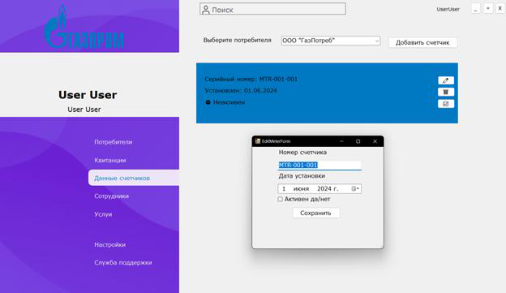
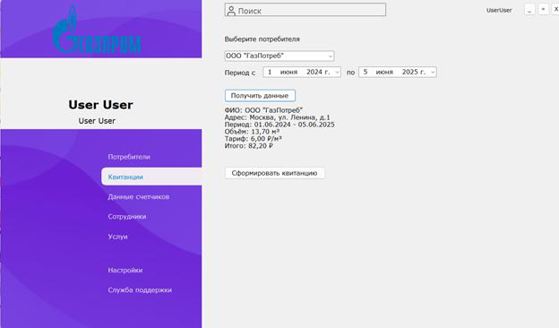
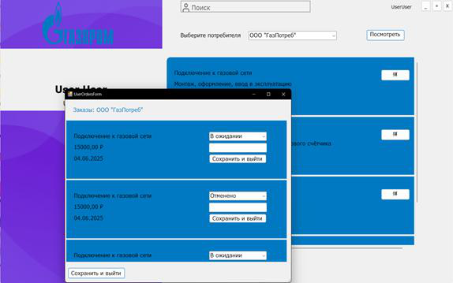
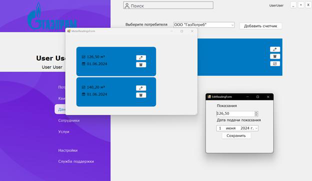
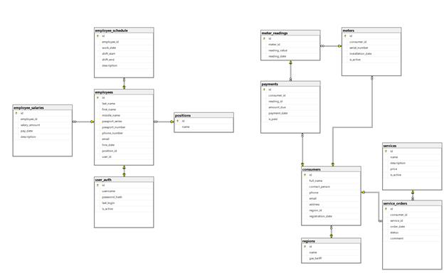

# Автоматизированная информационная система учёта данных

**Дипломный проект · 2025 · C# / Windows Forms / Microsoft SQL Server**

Учебная информационная система, разработанная в рамках выпускной квалификационной работы для моделирования процессов учёта сотрудников, потребителей газа, показаний счётчиков и платежей. Предметная область — деятельность газораспределительного предприятия.

> **Важно:** это дипломный/учебный проект, а не подтверждение официального внедрения системы в АО «Газпром газораспределение Тверь».

## Возможности

- Учёт сотрудников, их рабочих графиков и начислений заработной платы.
- Ведение данных потребителей и приборов учёта.
- Ввод показаний счётчиков и расчёт потребления.
- Расчёт начислений по тарифам.
- Формирование квитанций и экспорт документов в PDF.
- Генерация QR-кодов для квитанций.
- Регистрация и обработка заявок на услуги.
- Просмотр, добавление, изменение и фильтрация записей.

Функциональность описана в дипломной документации; исходный код приложения в этот архив не включён.

## Технологии

| Компонент | Технология |
| --- | --- |
| Язык программирования | C# |
| Пользовательский интерфейс | Windows Forms |
| База данных | Microsoft SQL Server |
| PDF-документы | iTextSharp |
| QR-коды | ZXing.Net |
| Графики | System.Windows.Forms.DataVisualization |
| Среда разработки | Visual Studio |

## Скриншоты интерфейса

### Учёт показаний счётчиков

### Формирование квитанции

### Работа с заявками

### Планирование графиков

## Проектирование базы данных

В дипломе представлена ER-диаграмма, включающая сущности сотрудников, потребителей, счётчиков, показаний, тарифов, платежей, услуг и заявок.

## Тестирование

В пояснительной записке описаны модульное, интеграционное и пользовательское тестирование, чек-листы и тест-кейсы. В частности, проверялись операции с записями, расчёты и экспорт PDF.

## О проекте

Проект выполнен как выпускная квалификационная работа в 2025 году. В репозитории представлены материалы из пояснительной записки, а не полный исходный код программы.

**Что демонстрирует:** проектирование реляционной базы данных, клиент-серверную модель, реализацию прикладной бизнес-логики, построение интерфейсов и документирование тестирования.

## Источник иллюстраций

Скриншоты и ER-диаграмма извлечены из дипломной пояснительной записки (рисунки на страницах 31 и 36–38). Перед публикацией рекомендуется проверить изображения на наличие реальных персональных или корпоративных данных.
